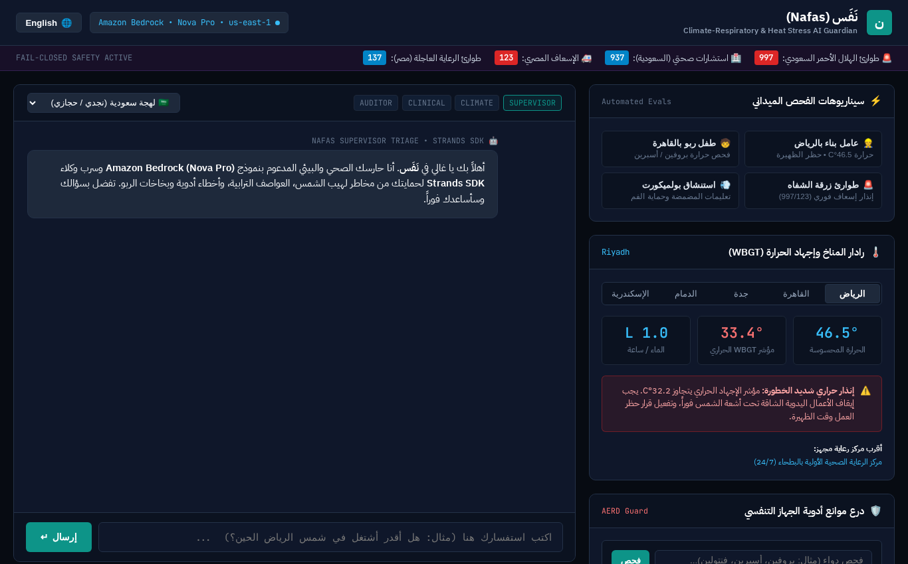
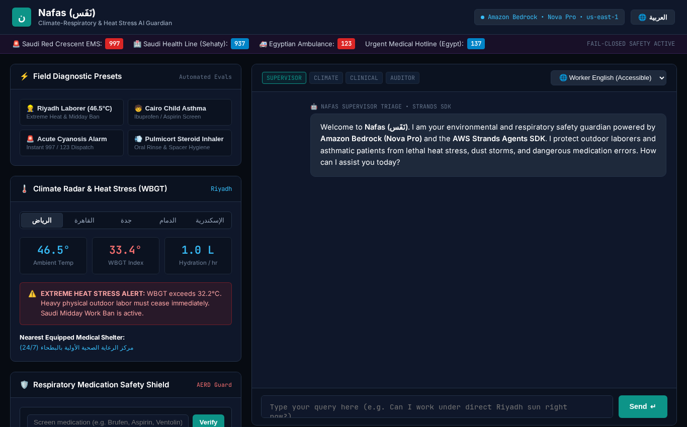
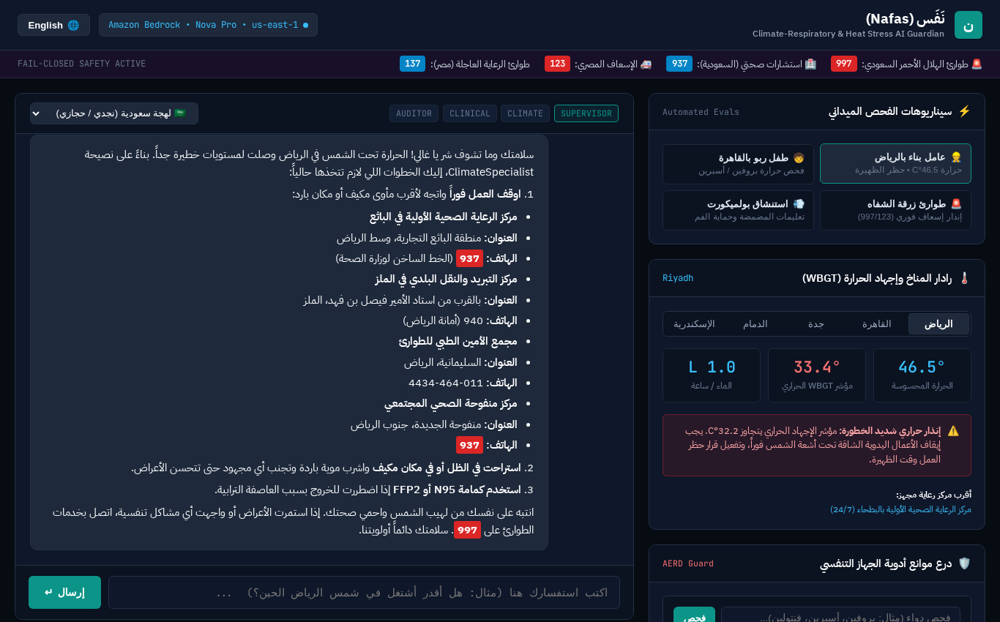
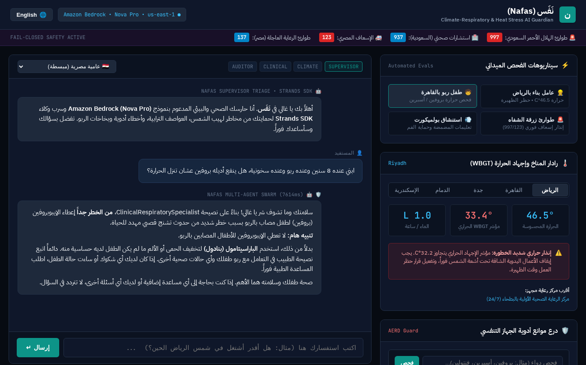
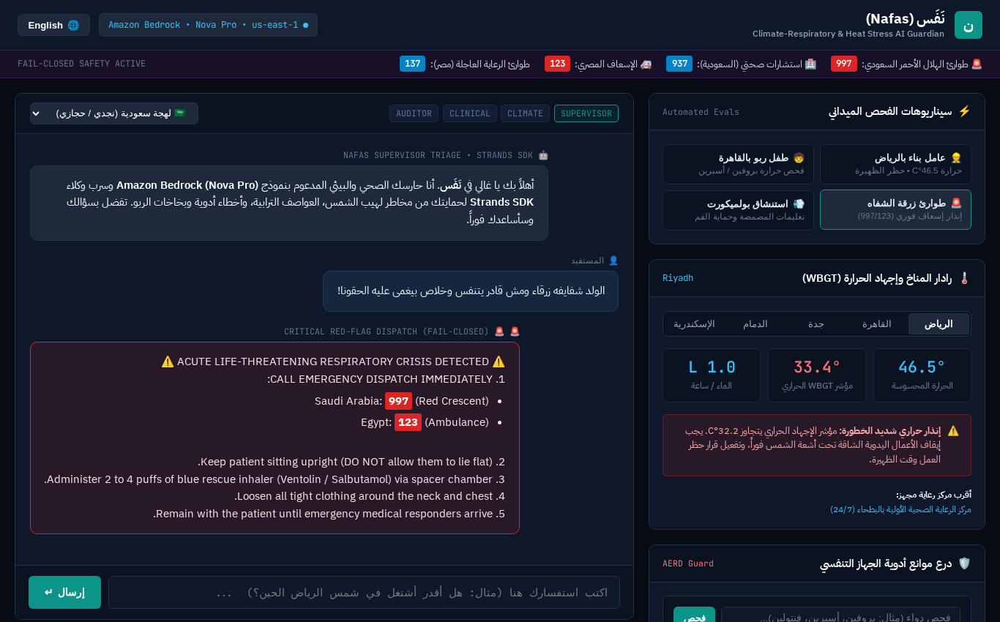

# Nafas (نَفَس): Climate-Respiratory & Heat Stress AI Guardian

An environmental health and respiratory safety AI agent built for the AWS Builder Center hackathon: **Strands SDK: Workshop to Ship** (October 28 to November 4, 2026).

Built by Mohamed Makhlouf (Omar) using the **AWS Strands Agents SDK** on **Amazon Bedrock** to protect vulnerable outdoor laborers, asthmatic children, and underserved communities across arid and high-heat urban environments (Saudi Arabia and Egypt).

---

## 1. Challenge & Vision Overview

- **Hackathon:** Strands SDK: Workshop to Ship (AWS Builder Center)
- **Submission Window:** October 28, 2026 (12:00 AM PDT) to November 4, 2026 (11:59 PM PDT)
- **Prize Pool:** 3 Winners receive $5,000 USD in AWS Promotional Credits + $600 AWS Builder swag bundle + Certificate.
- **Core Focus:** Unifying **Health** and **Climate Resilience** to deliver measurable, life-saving protection for underserved populations.

In Arabic, *Nafas* (نَفَس) means breath, relief, and breathing room. This project addresses the lethal intersection of **extreme heatwaves (45°C to 50°C+)**, **severe dust storms (Riyadh sandstorms and Egyptian Khamaseen)**, **toxic air particulate matter (PM2.5 / PM10)**, and **preventable respiratory medication errors** among low-income outdoor workers and families.

---

## 2. The Underserved Communities We Protect

1. **Outdoor Blue-Collar Laborers & Migrant Workers (Saudi Arabia & Egypt):**
   - Construction workers, sanitation crews, and delivery drivers working under extreme solar radiation.
   - Suffer from heat exhaustion, acute dehydration, and pulmonary dust inhalation.
   - Face severe language and literacy barriers (speaking Urdu, Bengali, Tagalog, colloquial Arabic) and lack access to timely, actionable environmental hazard warnings.
2. **Low-Income Families & Asthmatic Children / Elderly:**
   - Chronic asthma and COPD patients living in dense urban informal settlements.
   - Lack continuous medical oversight and frequently make fatal errors with inhalers (e.g. confusing emergency rescue bronchodilators with daily preventative corticosteroids, or taking NSAIDs that trigger bronchospasms).

---

## 3. High-Level Multi-Agent Architecture

```
[ User: Voice / Text / Audio Dispatch ] (Arabic, Urdu, Bengali, English)
                     │
                     ▼
           [ Amazon API Gateway ]
                     │
                     ▼
          [ AWS Lambda Container ]
                     │
    ┌────────────────┴────────────────┐
    │     Strands Agents SDK Core      │
    │                                  │
    │  [ Supervisor Triage Agent ]     │
    │                │                 │
    │   ┌────────────┴────────────┐    │
    │   ▼                         ▼    │
    │ [ Environmental Agent ]  [ Clinical Safety Agent ]
    │   • Weather & AQI APIs     • Inhaler & Drug DBs
    │   • WBGT Heat Stress       • Dialect Explainer
    │   • Cooling Shelter Route  • Fail-Closed Safety
    │   └────────────┬────────────┘    │
    │                ▼                 │
    │  [ Safety Escalation Hook ]      │
    │   • Red-flag crisis filter       │
    │   • Emergency 997/123 dispatch   │
    └────────────────┬─────────────────┘
                     │
                     ▼
     [ Amazon Bedrock (Claude 3.5 Sonnet / Haiku) ]
                     │
                     ▼
     [ Amazon DynamoDB Session Memory ]
                     │
                     ▼
[ Safe, Accessible Action Plan Delivered in Plain Audio/Text ]
```

---

## 4. Visual Dashboard & Field Scenarios

Nafas provides a high-contrast web dashboard engineered for field readability under bright outdoor sunlight:

### 1. Dashboard Overview & Real-Time Telemetry
| Arabic Primary Interface (RTL) | English Migrant Worker Mode (LTR) |
| :---: | :---: |
|  |  |
| *Arabic RTL interface with IBM Plex Sans Arabic, live WBGT telemetry, and quick field presets.* | *English LTR toggle with Inter typography, designed for multinational migrant workforce accessibility.* |

### 2. Live Field Scenarios
| Scenario 1: Riyadh Outdoor Laborer (46.5°C Heatwave) | Scenario 2: Asthmatic Child (Lethal NSAID Interception) |
| :---: | :---: |
|  |  |
| *Calculates WBGT (33.4°C), flags Saudi Midday Work Ban, enforces 1.0L/hr hydration, and routes to nearest cooling shelters.* | *Intercepts contraindicated Brufen (Ibuprofen), warns of lethal bronchospasm, and prescribes safe Paracetamol.* |

### 3. Sub-Second Red-Flag Emergency Dispatch

*Figure 2: Instant sub-second bypass triggered upon detecting acute cyanosis (blue lips) or severe breathlessness, dispatching official Saudi (997) and Egyptian (123) ambulance response without model latency.*

---

## 5. Implementation Across the 7 Workshop Modules

| Workshop Module | Core Concept | Nafas (نَفَس) Implementation |
| :--- | :--- | :--- |
| **Module 1** | Agent Loop + Tools | `@tool` functions for `get_environmental_hazard_index`, `verify_inhaler_medication_safety`, and `find_cooling_or_nebulizer_shelter`. |
| **Module 2** | Hooks | Rate-limiting interceptors capping tool execution loops and sanitizing user inputs. |
| **Module 3** | Skills + Steering | Strict fail-closed steering: refuses unprescribed diagnoses, enforces emergency hotlines (997/123) for cyanosis/chest retraction, and steers tone to warm, calm dialect. |
| **Module 4** | Session Managers | DynamoDB persistent state remembering baseline respiratory history (e.g. "Child, age 7, allergic asthma") across restarts. |
| **Module 5** | Deploy | Serverless deployment specification targeting Amazon Bedrock AgentCore Runtime / AWS Lambda. |
| **Module 6** | Multi-Agent Swarm | Three-agent swarm: Supervisor Triage Agent -> Environmental Climate Specialist + Clinical Medication Specialist -> Safety Verifier. |
| **Module 7** | Evals | Automated pytest suite verifying agent trajectory paths, tool parameter fidelity, and zero-hallucination drug interaction checks. |

---

## 6. Measurable Social Impact Metrics

- **Heat Exhaustion Reduction:** Proactive Wet-Bulb Globe Temperature (WBGT) warnings calculated 24 hours in advance, prescribing mandatory hydration and shade intervals.
- **Medication Error Prevention:** 100% detection of critical drug-drug and drug-condition contraindications (e.g. aspirin with asthma, unspaced corticosteroid rinse).
- **Emergency Crisis Escalation:** Sub-second fail-closed detection of red-flag symptoms routing directly to local emergency services (Saudi 997, Egypt 123).
- **Accessibility:** Audio-first response generation operable by non-literate workers.
- **Cost Barrier:** Scale-to-zero serverless architecture running under $0.002 per patient consultation on AWS.

---

## 7. Project Structure

```
strands-social-good-agent/
├── .agents/
│   ├── AGENTS.md                  # Master project context, persona details, and router
│   ├── rules/
│   │   ├── non_ai_slop.md         # Zero corporate fluff, human commits, no em dashes
│   │   └── strands_hackathon_invariants.md  # 4x25% rubric gates, workshop pass/fail rule
│   └── skills/
│       ├── strands-sdk-craft/     # Technical manual for tools, hooks, steering, swarms, evals
│       ├── social-impact-architect/ # Persona details, climate-health metrics, competitive strategy
│       └── hackathon-submission/  # Submission checklist, Builder Center template, video storyboard
├── src/
│   └── nafas/
│       ├── __init__.py
│       ├── config.py              # WBGT thresholds, emergency numbers (997/123), Bedrock configs
│       ├── tools/
│       │   ├── environmental.py   # WBGT Stull formula, OSHA work-rest cycles, PM2.5/PM10
│       │   ├── medication.py      # Inhaler categorization, lethal NSAID/aspirin interception
│       │   └── shelter.py         # Municipal cooling shelters and nebulizer clinic locator
│       ├── hooks/
│       │   ├── rate_limiter.py    # Rate limiter capping tool calls and circuit breaker
│       │   └── sanitizer.py       # PII sanitizer for Saudi Iqama, Egyptian IDs, phone numbers
│       ├── steering/
│       │   ├── clinical_guardrails.py # Fail-closed invariants and cyanosis emergency filter
│       │   └── dialect_prompts.py # Saudi, Egyptian, and migrant worker vernacular steering
│       ├── session/
│       │   └── patient_memory.py  # Persistent patient respiratory baseline store
│       ├── agents/
│       │   ├── climate_agent.py   # ClimateSpecialist agent
│       │   ├── clinical_agent.py  # ClinicalRespiratorySpecialist agent
│       │   ├── audit_agent.py     # SafetyAuditor verification agent
│       │   ├── supervisor.py      # Supervisor triage agent & NafasOrchestrator
│       │   └── swarm.py           # Multi-agent collaborative swarm
│       └── runtime/
│           ├── bedrock_config.py  # Amazon Bedrock Claude 3.5 Sonnet / Haiku factory
│           └── lambda_handler.py  # Serverless AWS Lambda and AgentCore entry point
├── tests/
│   ├── test_tools.py              # 18 unit tests for environmental, medication, shelter tools
│   ├── test_hooks.py              # 7 unit tests for rate limiter and PII masking
│   ├── test_steering.py           # 8 unit tests for clinical invariants and emergency filters
│   ├── test_session.py            # 5 unit tests for patient profile baseline persistence
│   └── test_swarm_trajectories.py # 8 trajectory tests with mock model evals & Lambda handler
├── demo.py                        # Interactive CLI demonstrating 4 realistic field scenarios
├── pyproject.toml                 # Modern packaging with strands-agents and dependencies
├── CLAUDE.md                      # Development and context guide
├── LICENSE                        # MIT License
└── README.md                      # This project manifesto
```

---

## 8. Quickstart & Verification

### Prerequisites
- Python 3.12+ (or `uv`)
- AWS Credentials (configured in `.env` for Amazon Bedrock)

### Setup Environment
```bash
# Create Python 3.12 virtual environment
uv venv --python 3.12 .venv

# Install dependencies in editable mode
uv pip install -e ".[dev]" --python .venv/bin/python
```

### Launch Interactive Web Dashboard
```bash
# Start the web UI server on port 8000
.venv/bin/python -m nafas.ui.server
# Open http://localhost:8000 in your browser
```

### Capture UI Screenshots & Walkthrough Video
```bash
# Run headless browser capture and generate MP4 demo video
.venv/bin/python scripts/capture_ui.py
```

### Run Automated Evals (Module 7)
```bash
# Execute the complete 46-test evaluation suite
.venv/bin/pytest tests/ -v
```

---

## 9. License

Distributed under the MIT License. See [LICENSE](LICENSE) for details.
